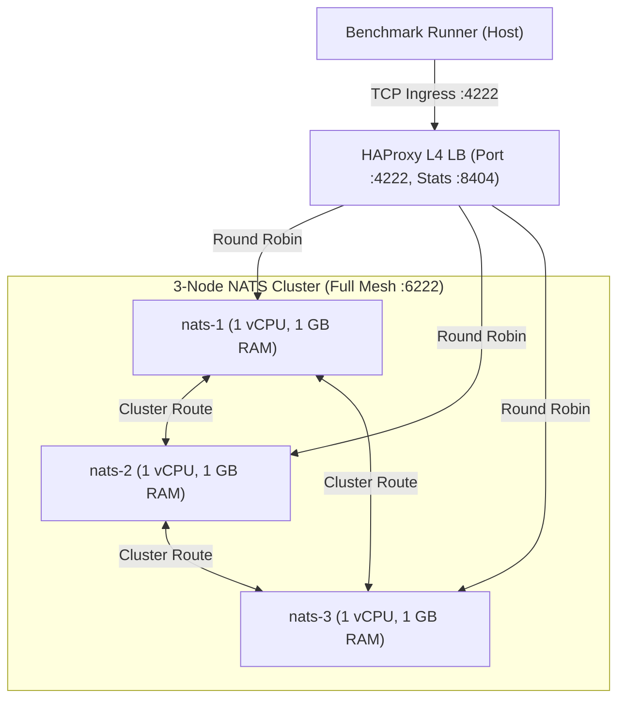

# NATS Capacity Benchmark - User & Execution Guide

A lightweight, portable benchmarking utility to evaluate NATS cluster throughput, latency distributions, and node resource consumption (CPU, Memory, Network I/O, Disk Block I/O).

---

## 1. Architecture Overview

The benchmarking utility tests a fixed multi-node NATS cluster through an L4 TCP load balancer, implementing the **OpenMessaging Benchmark (OMB)** time-bound execution standard and aligning with **Synadia's enterprise NATS benchmarking and TCO methodology** (McKnight Consulting Group evaluation):



- **Client Isolation**: The benchmark runner executes on the host machine outside container resource limits.
- **L4 Distribution**: Client connections are balanced across backend NATS nodes via HAProxy round-robin.
- **Resource Constraints**: Enforced at container level (1.0 CPU and 1 GB RAM per NATS node; 0.5 CPU and 512 MB for HAProxy).
- **Telemetry Collection**: Podman statistics collector samples per-container CPU, RAM, Network RX/TX, and Disk Block Read/Write in the background.

---

## 2. Prerequisites

Ensure the following tools are installed on your workstation:
- **Bash** (v3.2+ compatible)
- **NATS CLI** (`nats`)
- **Python 3** (Standard library only; no external pip dependencies)
- **Podman** & **Podman Compose**
- **jq**

### Podman Machine Sizing (macOS)
The benchmarking cluster requests up to **3.5 vCPUs** and **3.5 GiB RAM** across the 3 NATS nodes and HAProxy. To provide headroom for macOS hypervisor daemons (`gvproxy`, `virtiofsd`), ensure your Podman machine has at least **5 vCPUs** and **6 GiB RAM**:

```bash
# Check current Podman VM resource allocations:
podman machine info

# If resizing is needed:
podman machine stop
podman machine set --cpus 6 --memory 8192 --disk-size 100
podman machine start
```

---

## 3. Environment Setup & Deployment

The 3-node NATS cluster and HAProxy load balancer are configured in `deploy/compose.yaml`.

```bash
# 1. Start the cluster and load balancer in the background:
cd deploy
podman compose up -d

# 2. Verify containers are healthy and running:
podman ps

# 3. Access HAProxy live health and connection statistics:
open http://127.0.0.1:8404
```

To tear down the environment after testing:
```bash
cd deploy
podman compose down
```

---

## 4. Configuration Guide

Workload, telemetry, and environment parameters are unified in a single configuration file: `nats-capacity-benchmark/benchmark.conf`.
Parameters directly map to native `nats bench` CLI flags and container telemetry options:

```bash
# Test Identification
TEST_ID="TEST-1K-BASELINE"
TEST_DESCRIPTION="Core NATS 1 KiB baseline at 1,000 msgs/sec"

# Cluster Connection (--server)
NATS_URL="nats://127.0.0.1:4222"

# Engine & Scenario
# Options: pubsub, publish, subscribe, js-pub-sync, js-pub-async, js-consume
SCENARIO="pubsub"

# Concurrency & Workload Limits
CLIENTS=4                       # --clients (default concurrency for pub and sub)
PUBS=4                          # Publisher concurrency (overrides CLIENTS if set)
SUBS=4                          # Subscriber concurrency (overrides CLIENTS if set)
SIZE="1024B"                    # --size
THROUGHPUT=1000                 # --throughput (aggregate msgs/sec throttle; 0 for unthrottled)
DURATION="30s"                  # --duration (takes precedence over msgs when throughput > 0)
MSGS=30000                      # --msgs (used when throughput is 0 or duration unthrottled)

# Core NATS Routing Patterns
SUBJECT="benchmark.core.test"   # <subject>
QUEUE=""                        # --queue (blank for broadcast fan-out; set group name for load balancing)
MULTISUBJECT=false              # --multisubject
MULTISUBJECT_MAX=100000         # --multisubjectmax

# JetStream Specific Options (active when SCENARIO is js-*)
STREAM="BENCH_STREAM"           # --stream
CONSUMER="bench-consumer"       # --consumer
STORAGE="file"                  # file | memory
REPLICAS=3                      # Stream replication factor (1 or 3)
MAX_BYTES="5GB"                 # Stream storage quota
RETENTION="limits"              # limits | interest | workqueue
BATCH=500                       # --batch (for js-consume)
ACKS="explicit"                 # --acks (explicit | none | all)
PREPOPULATE_COUNT=0             # Prepopulate count for replay consume tests

# Container Telemetry Sampling
METRICS_BACKEND="podman"        # podman | none
CONTAINERS="nats-1 nats-2 nats-3"
METRICS_SAMPLE_INTERVAL=5       # seconds between stats samples
BASELINE_DURATION_SECONDS=15    # idle baseline sample duration
DISK_METRICS_BACKEND="local"    # local | cgroup
NATS_DATA_BASE_DIR="../deploy/data"
RESULTS_DIR="results"
```

### Environment Variable Overrides

Any configuration parameter can be overridden at runtime via environment variables without modifying files:

```bash
PUBS=8 SUBS=8 THROUGHPUT=20000 DURATION="60s" ./benchmark.sh
```

---

## 5. Execution Guide

Navigate to the benchmark workspace:
```bash
cd nats-capacity-benchmark
```

### 1. Run Preflight Health Check
Validates local dependencies, port reachability (`:4222`, `:8404`, monitoring ports `:8222-:8224`), and cluster routes:
```bash
./benchmark.sh --check
```

### 2. Run Default Benchmark
Executes the workload defined in `benchmark.conf`:
```bash
./benchmark.sh
```

### 3. Run with Environment Variable Overrides
Run immediate parameter sweeps without editing configuration files:
```bash
THROUGHPUT=5000 DURATION="60s" PUBS=4 SUBS=4 ./benchmark.sh
```

### 4. Run with a Custom Configuration File
Execute a standalone workload configuration:
```bash
./benchmark.sh path/to/custom-workload.conf
```

### 5. Launch Interactive Web UI & Configurator
Starts the local runner server with an interactive web UI at `http://127.0.0.1:8080` featuring visual scenario selection, real-time command building, live execution, and offline report viewing:
```bash
./benchmark.sh --serve
```

### 6. Re-aggregate Past Test Runs
Regenerate `results.json` and standalone `report.html` from an existing test directory without re-running the test:
```bash
python3 scripts/aggregate.py results/<TEST_ID>
```

### 7. Run Unattended Executive Benchmark Suites
Execute an entire test matrix unattended with automated cluster isolation, 10-second quiescence settling between runs, and consolidated executive reporting:
```bash
# Run predefined JetStream Cost of Guarantees suite:
./suite.sh jetstream-guarantees

# Or run by explicit path:
./suite.sh suites/core-ladder.conf
```

Available Predefined Suites (`suites/*.conf`):
- `jetstream-guarantees.conf`: Compares Core NATS, JetStream Memory R=3, JetStream File R=1, and JetStream File R=3.
- `core-ladder.conf`: Core NATS saturation ladder across offered rates (1k to 100k msgs/s).
- `jetstream-ladder.conf`: JetStream synchronous write saturation ladder (250 to 10,000 msgs/s).
- `payload-scaling.conf`: Payload dimension scaling from 128 B to 32 KiB.

---

## 6. Supported Workload Scenarios

### A. Core NATS
1. **Publish + Subscribe (`SCENARIO="pubsub"`)**:
   - Publishers and subscribers run simultaneously.
   - **Broadcast Mode (`QUEUE=""`)**: Every subscriber receives a full copy of every published message (Fan-out = Subscriber Concurrency).
   - **Queue Group Mode (`QUEUE="<queue_name>"`)**: Subscribers join a shared queue group, load-balancing messages across workers (Fan-out = 1x).
2. **Publish-Only (`SCENARIO="publish"`)**:
   - Publishers send messages without active subscribers to measure raw publishing throughput, connection handling, and server ingress routing without delivery costs.
3. **Subscribe-Only (`SCENARIO="subscribe"`)**:
   - Measures subscriber ingress consumption, connection handling, and delivery processing overhead.

### B. JetStream
1. **Synchronous Publish (`SCENARIO="js-pub-sync"`)**:
   - Publishers append messages to the stream and wait for consensus commit acknowledgment before proceeding (`nats bench js pub sync`).
2. **Asynchronous Publish (`SCENARIO="js-pub-async"`)**:
   - Pipelined asynchronous publishing without per-message round-trip wait (`nats bench js pub async`).
3. **Pull Consume (`SCENARIO="js-consume"`)**:
   - Durable pull consumers replay and acknowledge messages in batches from a pre-populated stream (`nats bench js consume`).

---

## 7. Results & Output Artifacts

Every benchmark run creates an organized output directory under `results/<TEST_ID>/` (or `results/<TEST_ID>/<TIMESTAMP>/` if `TIMESTAMP_SUBFOLDER=true`):

| File | Description | Primary Purpose |
| :--- | :--- | :--- |
| **`results.json`** | Canonical machine-readable benchmark results containing test metadata, client latency percentiles, achieved throughput, cluster rollups, and per-node resource metrics. | Automated data collection, CI/CD, trend analysis |
| **`report.html`** | Standalone, self-contained offline HTML report with responsive KPI cards, latency percentiles, node infrastructure table, cluster totals, console logs, and visual configurator. | Visual review, architecture reports, executive dashboards |
| **`metrics.json`** | Time-series container resource telemetry (CPU, memory, net RX/TX, block read/write, disk growth) sampled across baseline and workload phases. | Deep-dive telemetry, capacity analysis |
| **`pub.csv`** | Native CSV benchmark output from publisher client (MsgCount, MsgBytes, MsgsPerSec, BytesPerSec, and full latency percentiles). | Statistical analysis, audit trail |
| **`sub.csv`** | Native CSV benchmark output from subscriber client. | Delivery verification, bandwidth confirmation |
| **`test-config.txt`** | Complete snapshot of runtime parameters and configurations used during the test. | Test auditability, repeatability |
| **`workload_outcome.txt`** | Workload completion state (`COMPLETED`, `TIMEOUT`, `INTERRUPTED`). | Automation pipelines, status validation |

### Executive Suite Deliverables

When executing benchmark suites via `./suite.sh <suite-name>`, a consolidated suite directory is created under `results/suites/<SUITE_ID>/<TIMESTAMP>/` containing all individual test runs plus two executive deliverables:

| File | Description | Primary Purpose |
| :--- | :--- | :--- |
| **`suite-results.json`** | Canonical JSON rollup aggregating all child test runs, containing executive sizing boundaries (sustained capacity, saturation knee, peak throughput, cluster peak headroom). | Tooling, long-term capacity tracking |
| **`executive-report.html`** / **`suite-report.html`** | Offline executive dashboard featuring: (1) Sizing & Capacity Recommendation cards, (2) Pure SVG Throughput vs Latency Saturation Curve ("hockey stick" curve) with P50/P99 latency knee callouts, (3) Comparative "Cost of Guarantees" Matrix with direct links to per-test diagnostic reports, and (4) Interactive child-run drill-down drawer. Includes professional print/PDF styling. | Architecture reviews, leadership presentations, capacity sign-off |

---

## 8. Operational Notes & Troubleshooting

- **Rootless Podman**: When running rootless Podman on macOS, ensure the Podman machine has sufficient memory allocated (`podman machine info`).
- **Core NATS Block I/O**: Block read and write throughput for Core NATS will correctly read `0.000 MB/s` because Core NATS operates purely in-memory.
- **HAProxy Round-Robin**: If publisher or subscriber concurrency is less than the cluster node count (e.g. 1 pub and 1 sub across 3 nodes), only the connected nodes will observe workload ingress/egress. Idle nodes will show ~1 KB/s of background cluster heartbeat traffic.

---

## 9. Next Steps & Cross-References

- For the detailed metric definitions, calculation formulas, and enterprise sizing rules of thumb, see [docs/METRICS_AND_SIZING_GUIDE.md](docs/METRICS_AND_SIZING_GUIDE.md).
- For the Core NATS test case inventory and run cards, see [docs/tests.md](docs/tests.md).
- For the JetStream test case inventory and parameter sweep matrices, see [docs/tests-jetstream.md](docs/tests-jetstream.md).
- For the architectural design, evaluation methodology, and capacity planning standards, see [docs/benchmarking.md](docs/benchmarking.md).
