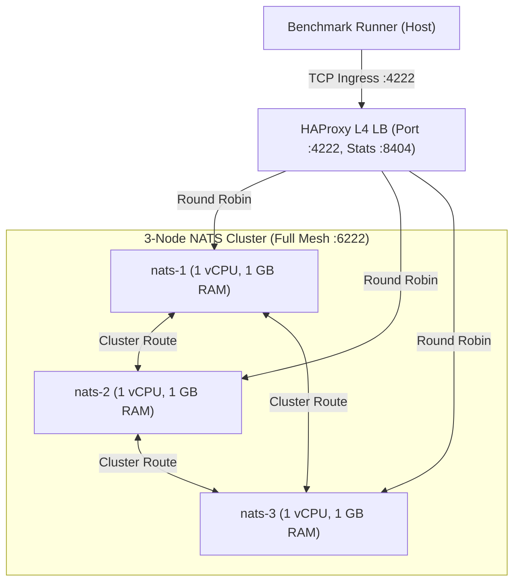

# NATS Capacity Benchmark - User & Execution Guide

A lightweight, portable benchmarking utility to evaluate NATS cluster throughput, latency distributions, and node resource consumption (CPU, Memory, Network I/O, Disk Block I/O).

---

## 1. Architecture Overview

The benchmarking utility tests a fixed multi-node NATS cluster through an L4 TCP load balancer, implementing the **OpenMessaging Benchmark (OMB)** time-bound execution standard and aligning with **Synadia's enterprise NATS benchmarking and TCO methodology** (McKnight Consulting Group evaluation):



Client connections access the 3-node full-mesh NATS cluster via an HAProxy L4 TCP load balancer (`:4222`), while background telemetry collectors sample per-container CPU, RAM, Network I/O, and Disk Block I/O.

---

## 2. Prerequisites

Ensure the following tools are installed on your workstation:
- **Bash** (v3.2+ compatible)
- **NATS CLI** (`nats`)
- **Python 3** (Standard library only; no external pip dependencies)
- **Podman** & **Podman Compose**
- **jq**

### Podman Machine Sizing (macOS)
The benchmarking cluster requests up to **3.5 vCPUs** and **3.5 GiB RAM** across the 3 NATS nodes and HAProxy. To provide headroom for macOS hypervisor daemons (`gvproxy`, `virtiofsd`), ensure your Podman machine has at least **6 vCPUs** and **8 GiB RAM**:

```bash
# Check current Podman VM resource allocations:
podman machine info

# If resizing is needed:
podman machine stop
podman machine set --cpus 6 --memory 8192 --disk-size 100
podman machine start
```

---

## 3. Environment Setup & Deployment

The 3-node NATS cluster and HAProxy load balancer are configured in `deploy/compose.yaml`.

```bash
# 1. Start the cluster and load balancer in the background:
cd deploy
podman compose up -d

# 2. Verify containers are healthy and running:
podman ps

# 3. Access HAProxy live health and connection statistics:
open http://127.0.0.1:8404/stats
```

To tear down the environment after testing:
```bash
cd deploy
podman compose down
```

---

## 4. Configuration Guide

Workload, telemetry, and environment parameters are unified in a single configuration file: `nats-capacity-benchmark/benchmark.conf`.
Parameters directly map to native `nats bench` CLI flags and container telemetry options:

```bash
# Test Identification
TEST_ID="TEST-1K-BASELINE"
TEST_DESCRIPTION="Core NATS 1 KiB baseline at 1,000 msgs/sec"

# Cluster Connection (--server)
NATS_URL="nats://127.0.0.1:4222"

# Engine & Scenario
# Options: pubsub, publish, subscribe, js-pub-sync, js-pub-async, js-consume
SCENARIO="pubsub"

# Concurrency & Workload Limits
CLIENTS=4                       # --clients (default concurrency for pub and sub)
PUBS=4                          # Publisher concurrency (overrides CLIENTS if set)
SUBS=4                          # Subscriber concurrency (overrides CLIENTS if set)
SIZE="1024B"                    # --size
THROUGHPUT=1000                 # --throughput (aggregate msgs/sec throttle; 0 for unthrottled)
DURATION="30s"                  # --duration (takes precedence over msgs when throughput > 0)
MSGS=30000                      # --msgs (used when throughput is 0 or duration unthrottled)

# Core NATS Routing Patterns
SUBJECT="benchmark.core.test"   # <subject>
PUB_SUBJECT=""                  # Publisher subject override (defaults to SUBJECT)
SUB_SUBJECT=""                  # Subscriber subject override (e.g. for wildcard > routing)
QUEUE=""                        # --queue (blank for broadcast fan-out; set group name for load balancing)
MULTISUBJECT=false              # --multisubject
MULTISUBJECT_MAX=100000         # --multisubjectmax
MULTISUBJECT_RANDOM=false       # --multisubjectrandomize

# JetStream Specific Options (active when SCENARIO is js-*)
STREAM="BENCH_STREAM"           # --stream
STREAM_COUNT=1                  # Number of concurrent JetStream streams (for stream density testing)
CONSUMER="bench-consumer"       # --consumer
CONSUMER_COUNT=0                # Concurrent active consumers (0 disables background consume)
STORAGE="file"                  # file | memory
REPLICAS=3                      # Stream replication factor (1 or 3)
MAX_BYTES="5GB"                 # Stream storage quota
RETENTION="limits"              # limits | interest | workqueue
BATCH=500                       # --batch (for js-consume)
ACKS="explicit"                 # --acks (explicit | none | all)
PREPOPULATE_COUNT=0             # Prepopulate count for replay consume tests

# Container Telemetry Sampling
METRICS_BACKEND="podman"        # podman | none
CONTAINERS="nats-1 nats-2 nats-3"
METRICS_SAMPLE_INTERVAL=5       # seconds between stats samples
BASELINE_DURATION_SECONDS=15    # idle baseline sample duration
DISK_METRICS_BACKEND="local"    # local | cgroup
NATS_DATA_BASE_DIR="../deploy/data"
RESULTS_DIR="results"
```

### Environment Variable Overrides

Any configuration parameter can be overridden at runtime via environment variables without modifying files:

```bash
PUBS=8 SUBS=8 THROUGHPUT=20000 DURATION="60s" ./benchmark.sh
```

---

## 5. Execution Guide

Navigate to the benchmark workspace:
```bash
cd nats-capacity-benchmark
```

### 1. Run Preflight Health Check
Validates local dependencies, port reachability (`:4222`, `:8404`, monitoring ports `:8222-:8224`), and cluster routes:
```bash
./benchmark.sh --check
```

### 2. Run Default Benchmark
Executes the workload defined in `benchmark.conf`:
```bash
./benchmark.sh
```

### 3. Run with Environment Variable Overrides
Run immediate parameter sweeps without editing configuration files:
```bash
THROUGHPUT=5000 DURATION="60s" PUBS=4 SUBS=4 ./benchmark.sh
```

### 4. Run with a Custom Configuration File
Execute a standalone workload configuration:
```bash
./benchmark.sh path/to/custom-workload.conf
```

### 5. Launch Interactive Web UI & Configurator
Starts the local runner server with an interactive web UI at `http://127.0.0.1:8080` featuring visual scenario selection, real-time command building, live execution, and offline report viewing:
```bash
./benchmark.sh --serve
```

### 6. Re-aggregate Past Test Runs
Regenerate `results.json` and standalone `report.html` from an existing test directory without re-running the test:
```bash
python3 scripts/aggregate.py results/<TEST_ID>
```

### 7. Run Unattended Executive Benchmark Suites
Execute an entire test matrix unattended with automated cluster isolation, 10-second quiescence settling between runs, and consolidated executive reporting:
```bash
# Run predefined JetStream Cost of Guarantees suite:
./suite.sh jetstream-guarantees

# Or run by explicit path:
./suite.sh suites/core-ladder.conf
```

Available Predefined Suites (`suites/*.conf`):
- `core-ladder`: Core NATS throughput saturation ladder across offered rates (1k to 100k msgs/s).
- `payload-scaling`: Message payload dimension scaling from 128 B to 32 KiB.
- `subject-cardinality`: Prefix trie routing and taxonomy scaling (1 to 10,000 subjects, wildcard `>`).
- `jetstream-ladder`: JetStream synchronous File R=3 write saturation ladder (250 to 10,000 msgs/s).
- `jetstream-guarantees`: Cost of guarantees (Core in-memory vs Memory R=3 vs File R=1/R=3).
- `stream-scaling`: Multi-Raft density scaling across 1 to 50 concurrent streams.
- `consumer-fanout`: Persistent Disk write multiplication and ACK amplification across 1 to 20 durable consumers.

---

## 6. Supported Workload Scenarios

The benchmark harness executes the **End-to-End Publish/Subscribe Operational Model**, evaluating simultaneous publishing, broker routing/persistence, and subscriber/consumer deliveries:

| Scenario ID | Engine | Pattern | Operational Delivery Flow |
| :--- | :--- | :--- | :--- |
| **`pubsub`** (`QUEUE=""`) | Core NATS | Broadcast Fan-Out | 1:N delivery to all active subscribers; egress scales linearly. |
| **`pubsub`** (`QUEUE="name"`) | Core NATS | Queue Groups | 1:1 load-balanced worker delivery; egress equals ingress. |
| **`js-pub-sync`** | JetStream | Replicated Publish | Synchronous append waiting for Raft quorum commit (`PUB-ACK`). |
| **`js-pub-sync`** (`CONSUMER_COUNT>0`)| JetStream | Consumer Fan-Out | Replicated publish with concurrent pull consumers and explicit ACKs. |

---

## 7. Results & Primary Deliverables

Every benchmark execution produces structured output under `results/<TEST_ID>/` (or `results/suites/<SUITE_ID>/<TIMESTAMP>/` for automated suites):

| Deliverable | Format | Scope | Primary Purpose |
| :--- | :--- | :--- | :--- |
| **`report.html`** | HTML | Single Run | Standalone offline dashboard with responsive KPI cards, latency tables, per-node hardware charts, and console logs. |
| **`results.json`** | JSON | Single Run | Machine-readable metrics: test metadata, client latency percentiles, achieved throughput, and cluster rollups. |
| **`suite-report.html`** / **`executive-report.html`** | HTML | Suite Rollup | Executive dashboard with SVG throughput vs. latency saturation curves, comparative matrices, and drill-down drawer. |
| **`suite-results.json`** | JSON | Suite Rollup | Aggregated JSON rollup capturing sustained capacity, saturation knees, and cluster peak headroom across all runs. |

---

## 8. Operational Notes & Troubleshooting

- **Rootless Podman**: When running rootless Podman on macOS, ensure the Podman machine has sufficient memory allocated (`podman machine info`).
- **Core NATS Block I/O**: Block read and write throughput for Core NATS will correctly read `0.000 MB/s` because Core NATS operates purely in-memory.
- **HAProxy Round-Robin**: If publisher or subscriber concurrency is less than the cluster node count (e.g. 1 pub and 1 sub across 3 nodes), only the connected nodes will observe workload ingress/egress. Idle nodes will show ~1 KB/s of background cluster heartbeat traffic.

---

## 9. Documentation Index

- **Architecture & Methodology**: `docs/benchmarking.md` (System topology, operational model, capacity lifecycle).
- **Test Inventory & Matrices**: `docs/tests.md` (Consolidated 7-suite inventory, parameters, execution flags).
- **Telemetry & Sizing Reference**: `docs/guide.md` (Metric definitions, latency quantiles, empirical bottleneck rules).
- **R&D Notes & Technical FAQs**: `docs/notes.md` (OFAT scientific rationale, standards citations, Two-Tier calibration).
- **Modeling Sufficiency**: `docs/model.md` (Decadal span sampling proof, USL regression, quantization law).
