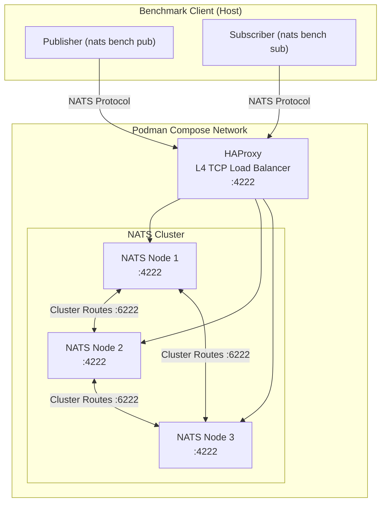
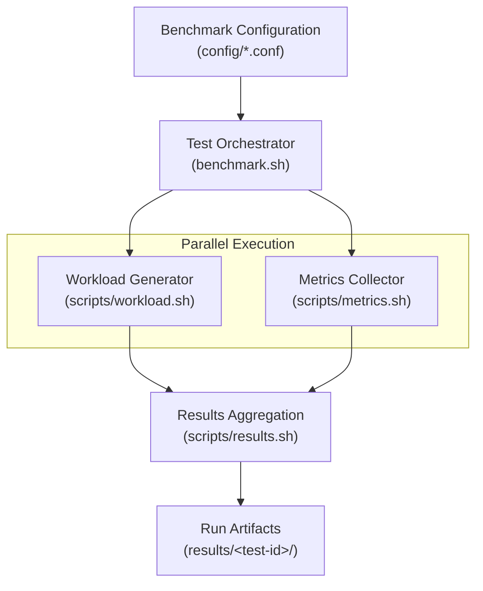

# NATS Capacity Benchmark

A benchmark and resource profiling framework for evaluating NATS platform capacity, throughput, and infrastructure resource consumption across a multi-node cluster.

The initial implementation focuses on **Core NATS workload execution** paired with **local container metrics collection** via Podman.

## Architecture

The benchmark environment deploys a 3-node clustered NATS topology behind an HAProxy Layer 4 TCP load balancer within a Podman Compose network. Benchmark traffic originates from client processes running on the host machine.



## Benchmark Workflow

The test orchestration runs in automated phases: loading configuration, executing publisher and subscriber workloads, capturing concurrent resource telemetry, and aggregating results into CSV datasets.



## Directory Structure

```text
nats-capacity-benchmark/
|
+-- benchmark.sh
+-- config/
|   +-- core-nats.conf
|   \-- jetstream.conf
|
+-- scripts/
|   +-- workload.sh
|   +-- metrics.sh
|   \-- results.sh
|
\-- results/
    \-- <test-id>/
        +-- test-config.txt
        +-- workload.log
        +-- subscriber.log
        +-- metrics.csv
        \-- summary.csv
```

## Prerequisites

* **Bash**: Shell runtime for test orchestrators.
* **NATS CLI**: Installed with support for `nats bench`.
* **Podman**: Required for local container orchestration and statistics (`METRICS_BACKEND=podman`).
* **jq**: Required for parsing JSON telemetry output from Podman.
* **Network Access**: Target NATS endpoint (e.g. `nats://127.0.0.1:4222`) reachable from the host.

## Running Benchmarks

### Default Execution

Run the benchmark using the default Core NATS configuration:

```bash
cd nats-capacity-benchmark
./benchmark.sh
```

### Custom Configuration

Pass an alternate configuration file as an argument:

```bash
cd nats-capacity-benchmark
./benchmark.sh config/core-nats.conf
```

Before running, verify the parameters in your configuration file. The default setup assumes:
* Target NATS containers are named `nats-1`, `nats-2`, and `nats-3`.
* Client ingress endpoint is `nats://127.0.0.1:4222`.

## Output Artifacts

Each test run creates an isolated timestamped directory under `results/<UTC-test-id>/` containing:

| Artifact | Description |
| --- | --- |
| `test-config.txt` | Snapshot of all configuration values and environment flags used for the run. |
| `workload.log` | Raw stdout/stderr output from the publisher benchmark process. |
| `subscriber.log` | Raw stdout/stderr output from the subscriber benchmark process. |
| `metrics.csv` | Time-series samples of per-container CPU, memory, network, and block I/O during baseline and active workload phases. |
| `summary.csv` | High-level execution summary, test parameters, and artifact paths. |

## Important Measurement Notes

* **Message Count Derivation**: `nats bench` targets an overall message count rather than purely running for a time window. The script derives `total_messages = target_msg_per_sec * target_duration_sec`, and passes the rate cap via `--throughput`.
* **Process Lifecycle**: The subscriber process (`nats bench sub`) is initialized first to ensure consumers are active before publisher traffic begins (`nats bench pub`). Concurrency on each side is governed by `--clients`.
* **Cumulative vs. Rate Metrics**: Podman container statistics report cumulative counters for network and block I/O. Throughput rates must be derived by comparing delta differences between timestamps rather than treating raw sample numbers as instantaneous rates.
* **Block I/O vs. IOPS**: Podman stats exposes block I/O byte volumes, not physical disk IOPS. Do not interpret block I/O counts as disk IOPS.
* **Rootless Networking Limitations**: Network I/O counters may be empty or unavailable in certain rootless Podman configurations on macOS or Linux. Unreported metrics should remain empty rather than assumed to be zero.
* **Measurement Boundary**: The benchmark scripts and `nats bench` client run on the host machine. Host client CPU and memory consumption are intentionally excluded from the per-container NATS metrics.
* **Collector Scope**: The initial collector measures NATS cluster container consumption. Host-level page cache, storage PV utilization, and HAProxy metrics are outside this measurement scope and should be captured separately.
