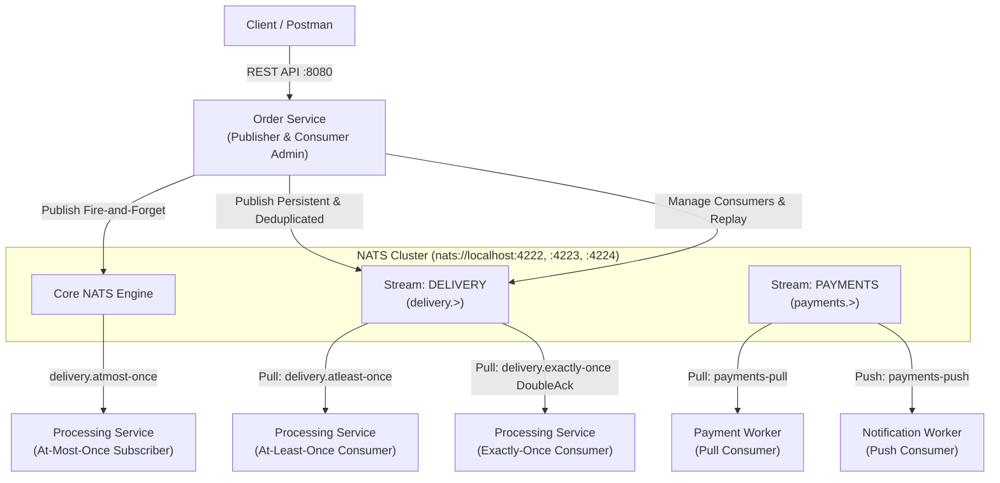

# NATS Demo

This repository is a NATS evaluation demo and reference implementation built with Go, Gin, and Zerolog. It demonstrates JetStream stream persistence, consumer configurations, delivery semantics.

---

## 1. System Architecture



- **Order Service (`services/cmd/order-service`)**: Exposed on port `:8080`. Provides REST APIs for publishing messages to Core NATS and JetStream (supporting at-most-once, at-least-once, and deduplicated exactly-once publishing) and managing consumer lifecycles.
- **Processing Service (`services/cmd/processing-service`)**: Worker evaluating message delivery semantics across three patterns:
  - At-Most-Once: Core NATS subscriber on `delivery.atmost-once`
  - At-Least-Once: JetStream pull consumer on `delivery.atleast-once` (stream `DELIVERY`)
  - Exactly-Once: JetStream pull consumer on `delivery.exactly-once` (stream `DELIVERY`) with `msg.DoubleAck()` and publisher deduplication
- **Payment Worker (`services/cmd/payment-worker`)**: Background worker that pulls and processes payment events from the `PAYMENTS` stream (`payments-pull` consumer).
- **Notification Worker (`services/cmd/notification-worker`)**: Background worker that consumes payment notifications from the `PAYMENTS` stream (`payments-push` consumer).

---

## 2. JetStream Stream Setup

Before running the workers or publishing messages, create the target streams using the NATS CLI. Streams persist messages and govern retention, storage, and deduplication tracking.

### Stream 1: PAYMENTS (Payment Processing & Notifications)
Used by `payment-worker` and `notification-worker` on subject pattern `payments.>`:
```bash
nats stream add PAYMENTS --subjects "payments.>" --storage file --retention limits --discard old --replicas 1 --defaults
```

### Stream 2: DELIVERY (Delivery Semantics & Failure Testing)
Used by `processing-service` on subject pattern `delivery.>` for at-least-once and exactly-once delivery testing. The `--dupe-window 2m` flag enables JetStream publisher message deduplication based on `Nats-Msg-Id`:
```bash
nats stream add DELIVERY --subjects "delivery.>" --storage file --retention limits --discard old --dupe-window 2m --replicas 1 --defaults
```

---

## 3. Running the Services

### Prerequisites
- Go 1.22+
- NATS Server with JetStream enabled (`nats-server -js`)
- NATS CLI (`nats`)

### 1. Start NATS Locally
- Single Node
```bash
nats-server -js
```
- Local Cluster using compose.yaml
```bash
cd deploy/local-nats-cluster
podman-compose up -d
```

### 2. Create Required Streams
Execute the stream creation commands from Section 2 for `PAYMENTS` and `DELIVERY`.

### 3. Environment Configuration (`.env`)
The Go services read runtime settings from `services/.env`. A ready-to-use template is provided in `services/.env.example`.

Copy the template to create your local `.env`:
```bash
cp services/.env.example services/.env
```

Key environment settings in `services/.env`:
- `NATS_SERVERS`: Comma-separated cluster endpoints. Defaults to the 3-node local cluster: `nats://localhost:4222,nats://localhost:4223,nats://localhost:4224`. If running a single node, set to `nats://localhost:4222`.
- `NATS_CONNECT_TIMEOUT` & `NATS_RECONNECT_WAIT`: Connection timeout (default `2s`) and reconnect interval (default `2s`) with exponential backoff up to 10s.
- `NATS_MAX_RECONNECT_ATTEMPTS`: Reconnection retries (default `10`). Set to `-1` for infinite retries.
- `NATS_TLS_ENABLED`: Set to `false` by default for local development. Set to `true` when connecting to TLS-enabled enterprise clusters.
- `NATS_AUTH_METHOD`: Authentication type (`token`, `user_password`, `jwt`, `credentials`). Commented out for local unauthenticated clusters.
- `ORDER_SERVICE_PORT`: HTTP server port for Order Service (default `:8080`).
- `PROCESSING_SERVICE_PORT`: HTTP server port for Processing Service (default `:8081`).

### 4. Start Order Service (REST API Publisher & Consumer Manager)
```bash
go run ./services/cmd/order-service
```

### 5. Start Processing Service (Delivery Semantics Worker)
```bash
go run ./services/cmd/processing-service
```

### 6. Start Payment Worker (Pull Consumer)
```bash
go run ./services/cmd/payment-worker
```

### 7. Start Notification Worker (Push Consumer)
```bash
go run ./services/cmd/notification-worker
```

---

## 4. API Reference

The Order Service exposes REST endpoints under `/api/v1` on port `:8080`.

All endpoints, pre-configured variables, and sample payloads can be imported directly into Postman via `nats_demo.postman_collection.json`.

| Method | Endpoint | Description | Postman Item Name |
| :--- | :--- | :--- | :--- |
| `POST` | `/api/v1/publish` | Publishes to Core NATS with at-most-once delivery (fire-and-forget); enriches headers and injects runtime unique short ID. | `NATS Publish (AtMost Once)` |
| `POST` | `/api/v1/publish/js` | Publishes to JetStream synchronously with at-least-once delivery; enriches headers, injects runtime short ID, and returns rich status with stream sequence. | `JetStream Publish (AtLeast Once)` |
| `POST` | `/api/v1/publish/js` | Publishes to JetStream with `Nats-Msg-Id` header for deduplication (exactly-once flow); returns enriched publish response with duplicate flag. | `JetStream Publish (Exactly Once)` |
| `POST` | `/api/v1/consumers` | Creates or retrieves a JetStream consumer (pull or push). | `Create Pull Consumer` / `Create Push Consumer` |
| `DELETE` | `/api/v1/consumers` | Deletes a JetStream consumer using a JSON body (`streamName`, `consumerName`). | `Delete Consumer` |
| `POST` | `/api/v1/consumers/replay` | Replays stream messages for audit/inspection (no business effect) by sequence or timestamp range; returns execution summary. | `Replay Messages (By Sequence)` / `Replay Messages (By Time)` |
| `POST` | `/api/v1/consumers/reprocess` | Reprocesses stream messages with business side-effects applied by sequence or timestamp range; returns reprocessing summary. | `Reprocess Messages (By Sequence)` / `Reprocess Messages (By Time)` |
| `GET` | `/api/v1/streams/:stream/sequences` | Returns stream sequence and timestamp boundaries (`firstSequence`, `lastSequence`, `firstTimestamp`, `lastTimestamp`, `messagesCount`) to guide replay. | `Get Stream Sequences` |

---

## 5. Logging & Observability

### Application Logging
Logging is managed by Zerolog (`github.com/rs/zerolog`).
- Development: Human-friendly colorful console output (`logger.Init(false)`).
- Production: Formatted structured JSON output (`logger.Init(true)`).

### JetStream System Advisories (Poison Messages & Max Deliveries)
Monitor real-time JetStream system advisories when consumers exhaust retries:
```bash
nats sub '$JS.EVENT.ADVISORY.CONSUMER.MAX_DELIVERIES.>'
```

For full evaluation notes, graceful/ungraceful crash results, and delivery semantic tests, see `services/report.md`.
