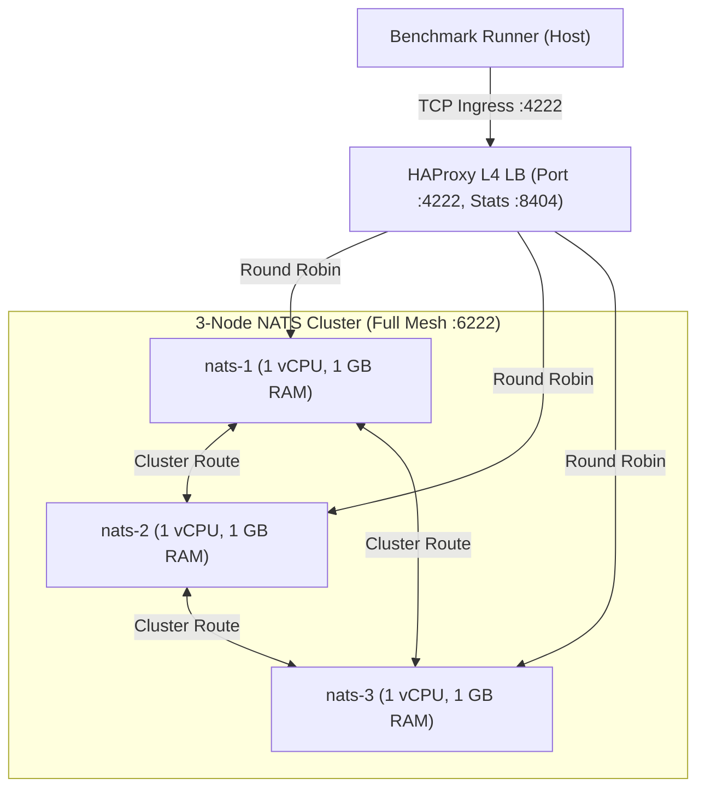

# NATS Capacity Benchmark - User & Execution Guide

A lightweight, portable benchmarking utility to evaluate NATS cluster throughput, latency distributions, and node resource consumption (CPU, Memory, Network I/O, Disk Block I/O).

---

## 1. Architecture Overview

The benchmarking utility tests a fixed multi-node NATS cluster through an L4 TCP load balancer, implementing the **OpenMessaging Benchmark (OMB)** time-bound execution standard and aligning with **Synadia's enterprise NATS benchmarking and TCO methodology** (McKnight Consulting Group evaluation):



- **Client Isolation**: The benchmark runner executes on the host machine outside container resource limits.
- **L4 Distribution**: Client connections are balanced across backend NATS nodes via HAProxy round-robin.
- **Resource Constraints**: Enforced at container level (1.0 CPU and 1 GB RAM per NATS node; 0.5 CPU and 512 MB for HAProxy).
- **Telemetry Collection**: Podman statistics collector samples per-container CPU, RAM, Network RX/TX, and Disk Block Read/Write in the background.

---

## 2. Prerequisites

Ensure the following tools are installed on your workstation:
- **Bash** (v3.2+ compatible)
- **NATS CLI** (`nats`)
- **Python 3** (Standard library only; no external pip dependencies)
- **Podman** & **Podman Compose**
- **jq**

### Podman Machine Sizing (macOS)
The benchmarking cluster requests up to **3.5 vCPUs** and **3.5 GiB RAM** across the 3 NATS nodes and HAProxy. To provide headroom for macOS hypervisor daemons (`gvproxy`, `virtiofsd`), ensure your Podman machine has at least **5 vCPUs** and **6 GiB RAM**:

```bash
# Check current Podman VM resource allocations:
podman machine info

# If resizing is needed:
podman machine stop
podman machine set --cpus 5 --memory 6144 --disk-size 50
podman machine start
```

---

## 3. Environment Setup & Deployment

The 3-node NATS cluster and HAProxy load balancer are configured in `deploy/compose.yaml`.

```bash
# 1. Start the cluster and load balancer in the background:
cd deploy
podman compose up -d

# 2. Verify containers are healthy and running:
podman ps

# 3. Access HAProxy live health and connection statistics:
open http://127.0.0.1:8404
```

To tear down the environment after testing:
```bash
cd deploy
podman compose down
```

---

## 4. Configuration Guide

Workload and environment configurations are strictly decoupled under `config/`:

### A. Environment Configuration (`config/environment.conf`)

Controls connection endpoints, metrics collectors, and output paths:

```bash
# Endpoint for benchmark traffic (points to HAProxy L4 listener)
NATS_URL="nats://127.0.0.1:4222"

# Infrastructure telemetry backend: "podman" or "none"
METRICS_BACKEND="podman"

# Physical disk metrics backend: "local" (host filesystem scan) or "cgroup" (container engine blkio)
DISK_METRICS_BACKEND="local"

# Host path containing per-node data directories (nats-1, nats-2, nats-3)
NATS_DATA_BASE_DIR="../deploy/data"

# Podman container names to monitor
NATS_CONTAINERS="nats-1 nats-2 nats-3"

# Telemetry sample interval (seconds) and idle baseline duration (seconds)
METRICS_SAMPLE_INTERVAL=5
BASELINE_DURATION_SECONDS=15

# Results directory (relative to nats-capacity-benchmark/ or absolute path)
RESULTS_DIR="results"
```

### B. Core NATS Workload Configuration (`config/core-nats.conf`)

Controls the messaging profile, scenarios, concurrency, and volume:

```bash
# 1. Test Scenario:
#   pubsub          - Concurrent publish and subscribe (default)
#   publish         - Publishers send without active subscribers
#   subscribe_setup - Connection and subscription establishment overhead
SCENARIO="pubsub"

# 2. Subscription Pattern (for pubsub scenario):
#   pubsub          - Normal Pub/Sub broadcast (fan-out = SUBSCRIBER_CONCURRENCY)
#   queue           - Queue group load balancing (fan-out = 1x)
SUBSCRIPTION_PATTERN="pubsub"
QUEUE_NAME="benchmark-core-group"

# 3. Subject Distribution:
#   single          - Single subject (SUBJECT)
#   multi           - Multiple subjects (--multisubject token distribution)
SUBJECT="benchmark.core.test"
SUBJECT_DISTRIBUTION="single"
MULTI_SUBJECT_MAX=10000

# 4. Workload Rate & Concurrency Limits:
TARGET_MSGS_PER_SEC=1000       # Target publication rate ceiling (msgs/sec)
MESSAGE_SIZE=1024              # Message payload size in bytes (e.g. 1024 = 1 KiB)
PUBLISHER_CONCURRENCY=1        # Concurrent publisher client connections
SUBSCRIBER_CONCURRENCY=1       # Concurrent subscriber client connections
TEST_DURATION_SECONDS=60       # Nominal test duration in seconds
```

### C. JetStream Workload Configuration (`config/jetstream.conf`)

Controls stream persistence, Raft replication quorum, consensus publish modes, and pull consumers:

```bash
MESSAGING_TYPE="JetStream"

# 1. Test Scenario:
#   pubsub   - Concurrent JetStream publish and pull consume (default)
#   publish  - Publishers append messages to stream without active consumers
#   consume  - Consumers replay from pre-populated stream without active publishers
SCENARIO="pubsub"

# 2. Stream Persistence & Quorum:
STREAM_NAME="BENCH_STREAM"
STREAM_SUBJECT="benchmark.js.test"
STORAGE_TYPE="file"               # "file" (disk storage) or "memory" (RAM-backed)
REPLICATION_FACTOR=3              # 1 (single node) or 3 (R=3 Raft quorum)
MAX_BYTES="5GB"                   # Stream max storage quota
RETENTION_POLICY="limits"         # "limits", "interest", or "workqueue"

# 3. Publishing & Consumer Settings:
JS_PUB_MODE="sync"                # "sync" (consensus commit wait) or "async" (pipelined)
CONSUMER_NAME="bench-consumer"
CONSUMER_ACK_POLICY="explicit"    # Explicit per-message acknowledgment
CONSUMER_BATCH_SIZE=500           # Pull batch fetch size

# 4. Workload Limits:
TARGET_MSGS_PER_SEC=1000
MESSAGE_SIZE=1024
PUBLISHER_CONCURRENCY=4
SUBSCRIBER_CONCURRENCY=2
TEST_DURATION_SECONDS=60
```

### D. Test Identification Configuration (`config/test.conf`)

Controls test naming, intent descriptions, and results folder mapping:

```bash
# Unique Test Identifier corresponding to tests.md (e.g. TEST-1.0, TEST-2.A1)
# Used as the child folder name under results/ (e.g. results/TEST-1.0/)
TEST_ID="TEST-1.0"

# Human-readable test intent and scope description
TEST_DESCRIPTION="Core NATS Baseline (Symmetric 1 Pub, 1 Sub, 1 KiB, 1K msgs/s)"

# Results directory hierarchy:
# false: store directly in results/${TEST_ID}/ (default)
# true : store in results/${TEST_ID}/${RUN_TIMESTAMP}/ to preserve historical runs
TIMESTAMP_SUBFOLDER=false
```

---

## 5. Execution Guide

Navigate to the benchmark workspace:
```bash
cd nats-capacity-benchmark
```

### 1. Run Preflight Health Check
Validates local dependencies, port reachability (`:4222`, `:8404`, monitoring ports `:8222-:8224`), and cluster routes:
```bash
./benchmark.sh --check
```

### 2. Run Default Benchmark
Executes the workload defined in `config/core-nats.conf` against `config/environment.conf` and `config/test.conf`:
```bash
./benchmark.sh
```

### 3. Run with Custom Configuration Files
Execute specific workloads and test IDs without modifying base configuration files:
```bash
./benchmark.sh path/to/custom-workload.conf path/to/custom-env.conf path/to/custom-test.conf
```

### 4. Re-aggregate Past Test Runs
Regenerate summary CSVs and HTML reports from an existing test directory without re-running the test:
```bash
python3 scripts/aggregate.py results/<TEST_ID>
```

### 5. Run Unattended Executive Benchmark Suites
Execute an entire test matrix unattended with automated cluster isolation, 10-second quiescence settling between runs, and consolidated executive reporting:
```bash
# Run predefined JetStream Cost of Guarantees suite:
./suite.sh jetstream-guarantees

# Or run by explicit path:
./suite.sh suites/core-ladder.conf
```

Available Predefined Suites (`suites/*.conf`):
- `jetstream-guarantees.conf`: Compares Core NATS, JetStream Memory R=3, JetStream File R=1, and JetStream File R=3.
- `core-ladder.conf`: Core NATS saturation ladder across offered rates (1k to 100k msgs/s).
- `jetstream-ladder.conf`: JetStream synchronous write saturation ladder (250 to 10,000 msgs/s).
- `payload-scaling.conf`: Payload dimension scaling from 128 B to 32 KiB.

---

## 6. Supported Workload Scenarios

### A. Core NATS
1. **Publish + Subscribe (`SCENARIO="pubsub"`)**:
   - Publishers and subscribers run simultaneously.
   - **Broadcast Mode (`SUBSCRIPTION_PATTERN="pubsub"`)**: Each subscriber receives a copy of all published messages ($Fan\text{-}out = \text{Subscriber Concurrency}$).
   - **Queue Group Mode (`SUBSCRIPTION_PATTERN="queue"`)**: Subscribers join a shared queue group, load-balancing messages across workers ($Fan\text{-}out = 1\times$).
2. **Publish-Only (`SCENARIO="publish"`)**:
   - Publishers push messages without active subscribers to measure raw publishing throughput, connection handling, and server ingress routing without delivery costs.
3. **Subscribe Setup (`SCENARIO="subscribe_setup"`)**:
   - Measures connection and subscription establishment overhead without message traffic. Reports connection rate (`conns/sec`) and server memory overhead per subscription.

### B. JetStream
1. **Publish + Consume (`SCENARIO="pubsub"`)**:
   - Concurrent publishing (sync or async) and durable pull consumers.
2. **Publish-Only (`SCENARIO="publish"`)**:
   - Measures write throughput, disk I/O write rate, and Raft consensus replication latency without consumer drain.
3. **Consume-Only (`SCENARIO="consume"`)**:
   - Pull consumer replay throughput, disk I/O read rate, and batch acknowledgment performance from a pre-populated stream.

---

## 7. Results & Output Artifacts

Every benchmark run creates an organized output directory under `results/<TEST_ID>/` (or `results/<TEST_ID>/<TIMESTAMP>/` if `TIMESTAMP_SUBFOLDER=true`):

| File | Description | Primary Purpose |
| :--- | :--- | :--- |
| **`report.html`** | Standalone, self-contained offline HTML report organized into Setup Details, Test Details, and Test Results (responsive KPI cards, latency percentiles, node infrastructure table, cluster totals, console logs, and print/PDF export styling). | Visual review, architecture reports, executive dashboards |
| **`summary.csv`** | Benchmark execution summary with test parameters, achieved publication/delivery rates, fan-out multiplier, cluster average/peak CPU and RAM, and exit codes. | Automated data collection, CI/CD, spreadsheet analysis |
| **`node-summary.csv`** | Per-container resource consumption breakdown: average and peak CPU %, RAM usage, Network RX/TX (MB/s), and Block Read/Write (MB/s). | Node balance analysis, identifying cluster bottlenecks |
| **`metrics.csv`** | Raw time-series telemetry sampled every `METRICS_SAMPLE_INTERVAL` seconds across all monitored cluster nodes. | Time-series charting, deep-dive resource analysis |
| **`workload.log`** | Execution console output from publisher clients and NATS CLI. | Latency percentiles (min, avg, P50, P90, P99, P99.9, max) |
| **`subscriber.log`** | Execution console output from subscriber clients. | Delivery verification, bandwidth confirmation, connection setup stats |
| **`test-config.txt`** | Complete snapshot of runtime parameters and configurations used during the test. | Test auditability, repeatability |

### Executive Suite Deliverables

When executing benchmark suites via `./suite.sh <suite-name>`, a consolidated suite directory is created under `results/suites/<SUITE_ID>/<TIMESTAMP>/` containing all individual test runs plus two executive deliverables:

| File | Description | Primary Purpose |
| :--- | :--- | :--- |
| **`executive-report.html`** | Offline executive dashboard featuring: (1) Sizing & Capacity Recommendation cards, (2) Pure SVG Throughput vs Latency Saturation Curve ("hockey stick" curve) with P50/P99 latency knee callouts, and (3) Comparative "Cost of Guarantees" Matrix with direct links to per-test diagnostic reports. Includes professional print/PDF styling. | Architecture reviews, leadership presentations, capacity sign-off |
| **`executive-summary.md`** | Portable GitHub Flavored Markdown summary of the suite recommendations and comparative matrix table. | Confluence documentation, PR descriptions, issue tracking |

---

## 8. Operational Notes & Troubleshooting

- **Rootless Podman**: When running rootless Podman on macOS, ensure the Podman machine has sufficient memory allocated (`podman machine info`).
- **Core NATS Block I/O**: Block read and write throughput for Core NATS will correctly read `0.000 MB/s` because Core NATS operates purely in-memory.
- **HAProxy Round-Robin**: If publisher or subscriber concurrency is less than the cluster node count (e.g. 1 pub and 1 sub across 3 nodes), only the connected nodes will observe workload ingress/egress. Idle nodes will show ~1 KB/s of background cluster heartbeat traffic.

---

## 9. Next Steps & Cross-References

- For the Core NATS test case inventory and run cards, see `tests.md`.
- For the JetStream test case inventory and parameter sweep matrices, see `tests-jetstream.md`.
- For the architectural design, evaluation methodology, and capacity planning standards, see `benchmarking.md`.
