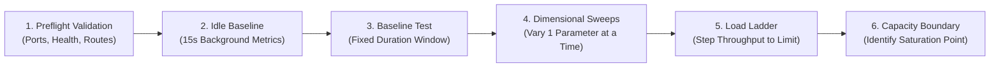

# NATS Capacity Benchmarking - Architecture & Methodology Design

## 1. Overview & Objectives

The objective of NATS Capacity Benchmarking is to quantify NATS Server resource consumption under diverse messaging workloads and identify sustainable throughput limits.

This benchmarking exercise provides empirical data to:
- Understand Core NATS and JetStream performance characteristics under controlled conditions.
- Measure CPU, memory, network, and storage consumption across cluster nodes.
- Understand the performance impact of message size, client concurrency, replication factors, and consumer configurations.
- Identify the maximum sustainable throughput boundary under fixed infrastructure limits.
- Establish infrastructure sizing models, capacity planning guidelines, and TCO estimations.

The benchmarking approach follows a controlled, workload-driven methodology aligned with the Linux Foundation's OpenMessaging Benchmark (OMB) framework and Synadia's enterprise NATS benchmarking and TCO evaluation methodology (McKnight Consulting Group study).

---

## 2. Benchmarking Test Scenarios

Benchmarking evaluates two core messaging engines: Core NATS (in-memory broadcast/queue) and JetStream (persisted, replicated streaming).

### 2.1 Core NATS Scenarios

| Scenario | Description | Primary Objective |
| :--- | :--- | :--- |
| **Publish** | Publishers transmit messages without active subscribers. | Measure raw publishing throughput, connection handling, and server ingress/routing costs without egress delivery overhead. |
| **Subscribe Setup** | Subscribers establish connections and active subscriptions without publishers. | Measure connection rate (`conns/sec`), handshake latency, and server memory footprint per active subscription. |
| **Publish + Subscribe** | Publishers and subscribers operate concurrently. | Measure end-to-end delivery throughput, client-side latency distributions, and the server resource impact of fan-out replication. |

#### Architectural Considerations:
- **In-Memory Semantics**: Core NATS does not persist messages to disk; disk block I/O is expected to be zero.
- **Subscribe Setup vs Message Throughput**: Subscribe setup measures connection and subscription metadata overhead; it must not be reported as message throughput.
- **Subscription Patterns**:
  - **Normal Pub/Sub (Broadcast)**: Every matching subscriber receives a distinct copy of each published message ($Fan\text{-}out = \text{Subscriber Concurrency}$).
  - **Queue Groups (Load Balancing)**: Messages published to a subject are distributed among members of the queue group ($Fan\text{-}out = 1\times$).

### 2.2 JetStream Scenarios

| Scenario | Description | Primary Objective |
| :--- | :--- | :--- |
| **Publish** | Publishers append messages to a JetStream Stream without active consumers. | Measure write throughput, disk I/O write rate, and Raft consensus replication latency. |
| **Consume** | Consumers retrieve previously persisted messages from a pre-populated Stream without active publishers. | Measure historical replay throughput, disk I/O read rate, and batch acknowledgment performance. |
| **Publish + Consume** | Publishers and consumers operate concurrently. | Measure sustainable throughput under concurrent publishing, disk persistence, Raft replication, delivery, and explicit acknowledgments. |

#### Architectural Considerations:
- **Prepopulation**: Consume-only tests must use a Stream pre-populated with steady-state message volumes.
- **Consumer Isolation**: Initial profiles evaluate durable pull consumers with explicit acknowledgment (`Explicit`).
- **Resource Cleanup**: Stream and consumer lifecycles must be isolated to benchmark-owned resources.

---

## 3. Workload Evaluation Dimensions

Workload dimensions define the parameter space systematically explored across tests.

### 3.1 Common Workload Dimensions

| Dimension | Description | Baseline Values |
| :--- | :--- | :--- |
| **Message Size** | Payload size of individual messages. | 1 KiB, 5 KiB, 10 KiB, 100 KiB |
| **Publisher Concurrency** | Number of concurrent publishing client processes/connections. | 1, 2, 4, 8 |
| **Consumer Concurrency** | Number of concurrent subscribing or consuming clients. | 1, 2, 4, 8 |
| **Target Throughput** | Configured rate ceiling (msgs/sec) or unthrottled. | 1k, 5k, 10k, 25k, 50k, unthrottled |
| **Test Duration** | Measurement window sufficient to achieve steady-state. | 30s - 60s |
| **Subject Cardinality** | Number of subjects traversed by the workload. | Single subject vs Multi-subject (1k, 10k) |

### 3.2 Core NATS Specific Dimensions

| Dimension | Scope & Impact |
| :--- | :--- |
| **Publisher Clients** | Concurrency of publishing connections through the load balancer. |
| **Subscriber Clients** | Concurrency of subscribing connections receiving message streams. |
| **Subscription Pattern** | Normal Pub/Sub broadcast vs Queue Group load-balancing. |
| **Fan-Out Multiplier** | Ratio of delivered messages to published messages ($\text{Deliveries} / \text{Publications}$). |
| **Subject Distribution** | Single subject vs tokenized multi-subject routing trees (`--multisubject`). |

### 3.3 JetStream Specific Dimensions

| Dimension | Description | Baseline Setting |
| :--- | :--- | :--- |
| **Storage Type** | Storage engine for stream persistence. | `File` (disk storage) |
| **Replication Factor** | Number of Stream replicas maintained across cluster nodes. | `3` (R=3 Raft cluster) |
| **Retention Policy** | Retention criteria for stream cleanup. | `Limits` (size / age / count) |
| **Consumer Delivery** | Mechanism used to retrieve stream messages. | `Pull` (client batch fetch) |
| **ACK Policy** | Message receipt acknowledgment contract. | `Explicit` (per-message ACK) |

---

## 4. Infrastructure Baseline & Deployment Architecture

To ensure scientific validity and repeatability, the infrastructure configuration remains fixed throughout a benchmark series:

```
[ Benchmark Client (Host) ]
            |
            v  (Port :4222)
    [ HAProxy L4 LB ]  (0.5 CPU, 512 MB)
      /     |     \
     /      |      \
    v       v       v
[nats-1] [nats-2] [nats-3]  (Each: 1.0 CPU, 1 GB RAM, Disk Quotas)
   |<====== Full Mesh Cluster Routes (Port :6222) ======>|
```

### Infrastructure Specifications:
- **Node Count**: 3-node NATS cluster running in full-mesh clustering (`nats-1`, `nats-2`, `nats-3`).
- **Resource Constraints**: Fixed CPU quotas (`cpus: 1.0`) and memory limits (`mem_limit: 1g`) enforced via container configuration.
- **Client Ingress**: Client connections access the cluster exclusively through an L4 TCP load balancer (HAProxy) using round-robin distribution.
- **Isolation**: Benchmark workload clients run on the host machine outside the NATS container runtime to prevent client CPU contention with server nodes.

---

## 5. Capacity Identification Methodology

The benchmark follows a **Time-Bound Fixed Infrastructure + Incremental Load** methodology (aligned with OpenMessaging Benchmark and SPEC standards):



### Steps:
1. **Preflight Verification**: Validate network reachability, cluster quorum, monitoring URLs, and dependency tooling.
2. **Idle Baseline**: Sample 15 seconds of idle cluster metrics to establish background CPU/RAM floors.
3. **Time-Bound Execution**: All workload tests execute within a strictly enforced duration window (`TEST_DURATION_SECONDS`). Even when an offered rate exceeds hardware limits (e.g. 1M msgs/s), the test terminates predictably at the configured duration and captures the true achieved throughput and saturation latency.
4. **Capacity Boundary Identification**: Maximum sustainable throughput is defined as the highest throughput achieved where:
   - Message delivery efficiency is 100% (zero message drop or unhandled errors).
   - Server CPU utilization exhibits headroom (<80-85% peak across all nodes).
   - Client-side P99 latency remains within acceptable SLA thresholds (typically < 10 ms).
   - Inter-node cluster routes remain healthy without queue overflows.

### Formal Test Execution Outcomes:
Every test run classifies its lifecycle into one of four standard states:
- **`COMPLETED`**: Workload executed as expected within the designated duration with exit code 0.
- **`TIMEOUT`**: Execution exceeded the allowed duration window (e.g. unresponsive process or subscriber drain timeout).
- **`FAILED`**: Publisher, consumer, or benchmark process exited with a runtime error or non-zero exit code.
- **`INTERRUPTED`**: Workload was aborted or cancelled manually via `Ctrl+C` (`SIGINT`/`SIGTERM`).

---

## 6. Telemetry & Results Architecture

Every benchmark execution generates a structured, immutable artifact bundle within a timestamped directory:

| Artifact | Purpose | Primary Consumer |
| :--- | :--- | :--- |
| **`results.json`** | Canonical machine-readable benchmark results containing test metadata, client latency percentiles, achieved throughput, cluster rollups, and per-node resource metrics. | Automated tooling, CI/CD, Trend Analysis |
| **`report.html`** | Self-contained, zero-dependency offline HTML dashboard with test outcome badge, KPI cards, latency percentiles, per-node hardware telemetry, and configurator. | Humans, Architects, Stakeholders |
| **`metrics.json`** | Time-series container resource telemetry (CPU, memory, net RX/TX, block read/write, disk growth) sampled across baseline and workload phases. | Deep-dive telemetry, Capacity Engineers |
| **`pub.csv`** | Native CSV benchmark output from publisher client (MsgCount, MsgBytes, MsgsPerSec, BytesPerSec, and full latency percentiles). | Statistical Analysis, Audit trail |
| **`sub.csv`** | Native CSV benchmark output from subscriber client. | Delivery verification, Bandwidth confirmation |
| **`test-config.txt`** | Full configuration snapshot used for the benchmark run. | Repeatability, Audit trail |

### 6.1 Executive Suite Comparative Deliverables

When running benchmark suites (`./suite.sh <suite-name>`), individual test runs are aggregated into an executive-level presentation bundle located in `results/suites/<SUITE_ID>/<TIMESTAMP>/`:

| Artifact | Purpose | Primary Consumer |
| :--- | :--- | :--- |
| **`suite-results.json`** | Canonical JSON rollup aggregating all child test runs, containing executive sizing boundaries (sustained capacity, saturation knee, cluster peak headroom). | Tooling, Long-term capacity tracking |
| **`executive-report.html`** / **`suite-report.html`** | Offline dashboard featuring: (1) Executive sizing recommendations cards, (2) Inline SVG Throughput vs Latency saturation curve ("hockey stick" curve) with P50/P99 latency knee callouts, (3) Comparative Matrix table, and (4) Interactive child-run drill-down drawer. | Enterprise Architects, Engineering Leadership |

---

## 7. Phased Implementation Roadmap

- **Phase 1: Baseline Scenarios**: Core NATS and JetStream baseline workloads under standard parameters.
- **Phase 2: Dimensional Scaling**: Systematic exploration of concurrency, message sizes, and fan-out multipliers.
- **Phase 3: JetStream Persistence & Replication**: Evaluation of File vs Memory storage, R=1 vs R=3 replication overhead, and retention limits.
- **Phase 4: Consumer Optimization**: Pull vs Push delivery modes, ACK policies, batch sizes, and worker concurrency.
- **Phase 5: Production Capacity & Sizing Standards**: Deriving hardware sizing formulas, operational limits, and enterprise deployment guidelines.

---

## 8. References
https://www.synadia.com/downloads/nats-kafka-tco-report.pdf
