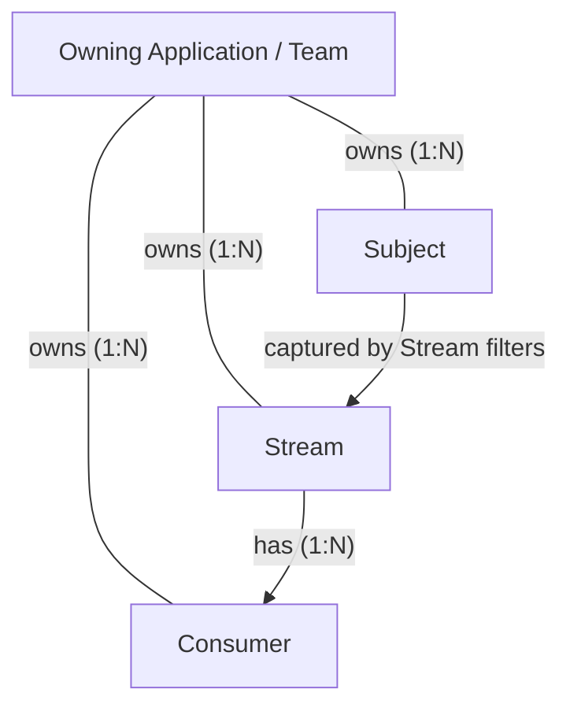
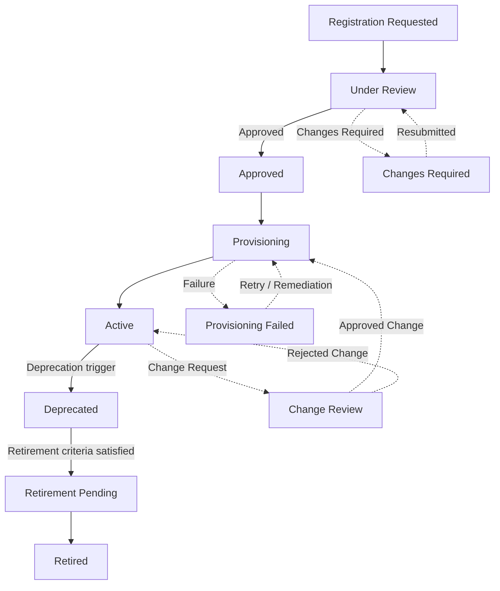

# NATS Resource Lifecycle Management

## 1. Overview

NATS Resource Lifecycle Management defines the enterprise process for governing **Subjects, Streams, and Consumers** across the organization's NATS messaging platform.

It establishes a consistent approach to resource standards, ownership, registration, discovery, request and approval, provisioning, operation, change management, deprecation, and retirement. The framework ensures that messaging resources are managed consistently across application teams and Platform/SRE teams, with appropriate controls for security, reliability, persistence, and operational governance.

The framework applies to all three resource types while accounting for their distinct roles and dependencies within NATS. It defines the organizational controls and processes around these resources without replacing native NATS capabilities or configuration.

## 2. Resource Lifecycle Management Scope

The framework covers the following governance domains:

| # | Governance Domain | Scope |
|---|---|---|
| 1 | **Standards and Governance** | Define and govern naming, resource design, access, persistence, retention, and configuration standards applicable to Subjects, Streams, and Consumers. |
| 2 | **Ownership and Accountability** | Establish resource ownership and responsibilities across application and Platform/SRE teams. |
| 3 | **Registry and Discovery** | Maintain a central registry of resource ownership, metadata, relationships, configuration references, and lifecycle status. |
| 4 | **Request, Approval and Provisioning** | Define the request, review, maker-checker approval, registration, and applicable NATS configuration or provisioning processes. |
| 5 | **Operation and Change Management** | Govern resource changes, ownership updates, dependencies, permissions, subject-to-Stream mappings, Consumer configuration, and configuration drift. |
| 6 | **Deprecation and Retirement** | Define dependency assessment, migration, retirement approval, data-retention considerations, and associated configuration cleanup. |

**Out of scope:** Cluster and Account lifecycle management, and message envelope and schema management. These are addressed through separate platform governance and technical standards.

## 3. Resource Relationships

The following diagram illustrates the organizational ownership of resources and their primary relationships within NATS.

### 3.1 Key Invariants

1. **Subjects can exist without Streams.** Subjects support Core NATS messaging without persistence.
2. **Streams require subject filters.** A Stream captures messages published to subjects matched by its configured filters.
3. **Streams can exist without Consumers.** Messages can be persisted in a Stream before a Consumer is created.
4. **A Consumer belongs to exactly one Stream.** A Stream can have zero or more Consumers.
5. **Consumer filters must be compatible with the Stream's subject configuration.** A Consumer must not request messages outside the scope captured by its Stream.
6. **Overlapping subject capture is restricted.** Under the standard JetStream model, independently configured Streams in the same Account must not have overlapping subject capture. Source and mirror configurations require separate consideration.
7. **Resource ownership must be identifiable.** Each Subject, Stream, and Consumer must have a designated owning application or team in the organizational governance model.

These invariants guide resource design and governance. They do not replace the detailed technical requirements documented in the resource-specific design standards.

## 4. Resource Design Standards

The technical design standards for NATS resources are maintained in separate documents. These documents define resource-specific conventions, configuration standards, and design criteria that must be followed when onboarding or modifying resources.

| Resource | Design Document | Purpose |
|---|---|---|
| Subject | [Subject Design] | Defines subject naming conventions, namespace structure, ownership, and subject design principles. |
| Stream | [Stream Design] | Defines Stream naming, subject-to-Stream mapping, Stream separation and reuse criteria, retention, and persistence standards. |
| Consumer | [Consumer Design] | Defines Consumer naming, configuration standards, delivery patterns, filtering, acknowledgement, and lifecycle considerations. |

These design documents serve as technical references for the Resource Lifecycle Management process. Resource requests and changes must comply with the applicable standards. Deviations must be handled through the defined technical governance and approval process.

## 5. Roles and Responsibilities

| Role | Responsibilities |
|---|---|
| **Application Team** | Defines resource requirements, submits requests, identifies known dependencies, validates application integration, and coordinates required migrations. |
| **Platform/SRE Team** | Validates technical compliance, determines resource configurations, provisions resources, maintains governance records, and assesses operational impact. |
| **Designated Approver** | Approves governed changes, exceptions, and retirement decisions in accordance with organizational policy. |

The designated approver may be a Platform/SRE lead, application owner, or another authorized authority, depending on the type and impact of the request.

## 6. Resource Lifecycle

The lifecycle defines the governed progression of a resource from registration request through active use and eventual retirement. The same high-level lifecycle applies to Subjects, Streams, and Consumers, although the implementation differs by resource type.

### 6.1 Lifecycle Diagram

### 6.2 Lifecycle Transition Criteria

| State | Transition Criteria |
|---|---|
| **Registration Requested** | The Application Team submits a request containing the resource purpose, ownership, intended usage, known dependencies, and applicable design requirements. |
| **Under Review** | Platform/SRE validates naming, ownership, resource relationships, design compliance, security, capacity, and operational requirements as applicable. |
| **Approved** | Required technical reviews and approvals are complete, and the request is authorized for implementation. |
| **Provisioning** | The approved request is implemented, including resource registration, NATS configuration, or runtime provisioning as applicable. |
| **Active** | The resource is registered or provisioned, as applicable, and verified as ready for its approved intended use. |
| **Changes Required** | The request does not satisfy validation requirements. Findings are returned to the Application Team for correction and resubmission. |
| **Provisioning Failed** | Implementation has failed. Platform/SRE investigates, remediates, and retries before the resource can become Active. |
| **Change Review** | A proposed modification is assessed for standards compliance, dependencies, compatibility, operational impact, and required approvals. |
| **Deprecated** | An authorized decision has been made to phase out the resource because it is no longer required, is being replaced, or has another approved deprecation reason. New dependencies should not be introduced. |
| **Retirement Pending** | Retirement prerequisites are being verified, including dependency migration or removal, required approvals, and applicable retention or compliance obligations. |
| **Retired** | The resource has been withdrawn from approved use, applicable runtime configuration has been cleaned up, and the lifecycle record has been updated. |

**Lifecycle notes:**

- A resource's lifecycle state is distinct from the state of a request to change it. An Active resource normally remains Active while its modification is under review.
- Deprecation and retirement require explicit decisions and prerequisite checks; they are not automatic transitions.
- A Subject's Active state represents approved registration and governance records, with any required authorization or related configuration in place. A Stream or Consumer's Active state also requires runtime provisioning and verification.
- A resource must not be retired solely because it is unused at a particular point in time; applicable dependencies and retention obligations must first be assessed.

## 7. Request, Approval and Provisioning Process

Resource onboarding and modification follow a controlled process to ensure compliance with design standards and operational requirements.

1. **Submit request:** The Application Team provides the resource requirements, purpose, ownership, intended usage, known dependencies, and relevant design information.
2. **Validate request:** Platform/SRE reviews the request against the applicable Subject, Stream, or Consumer Design standards and checks the proposed resource relationships.
3. **Approve or return:** Requests that meet the requirements proceed for approval. Requests requiring correction are returned to the Application Team. Exceptions follow the approved exception process.
4. **Provision or register:** Platform/SRE implements the approved change. This may involve recording a Subject, configuring a Stream, creating a Consumer, or updating related authorization and runtime configuration.
5. **Verify and record:** Platform/SRE verifies the outcome and updates the applicable governance records, including ownership, configuration references, relationships, and lifecycle status.
6. **Confirm readiness:** The Application Team validates application integration where required, and the resource is made available for its approved intended use.

The request, approval, and implementation steps must maintain an auditable record of the decision and resulting changes.

## 8. Change Impact and Dependency Management

Changes to or retirement of a Subject, Stream, or Consumer must be assessed for their impact on dependent resources and application integrations before implementation.

- **Application Team:** Identifies known dependencies, evaluates application impact, and coordinates required application changes or migrations.
- **Platform/SRE Team:** Validates technical impact, checks affected resource relationships, and ensures that required approvals and migration or retirement prerequisites are satisfied before implementation.

Changes that affect subject-to-Stream mappings, Consumer behavior, access permissions, retention, or resource ownership must be reviewed against the applicable design standards.

Retirement must not proceed until required dependencies have been migrated or removed and applicable retention and compliance obligations have been satisfied.

## 9. Exceptions and Non-compliance

Resource requests must comply with approved NATS resource design standards and governance policies. Requests that do not comply must be returned for correction or submitted through the approved exception process.

An exception request must include:

- The requirement or standard for which an exception is sought.
- Business or technical justification.
- Identified risks and proposed mitigations.
- The requested duration or review conditions, where applicable.
- Approval from the designated authority.

Approved exceptions must be documented and remain subject to applicable security, operational, and compliance requirements. Approval of an exception does not remove the need to record and govern the resource throughout its lifecycle.

## 10. Operating Model: Phase 1 and Future Platformisation

Resource Lifecycle Management will initially be implemented through controlled, manually executed processes using the existing NATS platform and organizational workflows. As platform capabilities mature, these processes can evolve towards workflow automation, self-service, and policy-driven provisioning.

The governance standards, approval requirements, and resource lifecycle controls remain consistent across both phases. The primary difference is the degree of automation and integration.

| Capability | Phase 1: Controlled Manual Process | Future: Platformised NATS |
|---|---|---|
| **Request** | Ticket or standardized request template | Self-service portal/API |
| **Validation and approval** | Manual validation, review, and maker-checker approval | Automated validation and workflow-driven approval |
| **Registry** | Central document or version-controlled repository | Authoritative, searchable registry integrated with platform workflows |
| **Provisioning** | Controlled manual configuration of NATS resources and applicable authorization settings | Automated provisioning with policy validation and enforcement |
| **Change management** | Ticket-based changes, dependency assessment, and version history | Integrated change workflows, impact analysis, and automated validation |
| **Retirement** | Manual dependency verification, approval, and controlled configuration cleanup | Workflow-driven retirement with dependency checks and controlled cleanup |
| **Auditability** | Tickets, approval records, and repository history | Integrated audit trail and resource lifecycle history |

Platformisation improves consistency, traceability, and execution efficiency without changing the underlying governance standards or approval requirements.

## 11. Related Documents and References

| Document | Purpose |
|---|---|
| **Subject Design** | Subject naming, namespace design, ownership, and subject design standards. |
| **Stream Design** | Stream naming, subject mapping, separation and reuse criteria, persistence, and retention standards. |
| **Consumer Design** | Consumer configuration, delivery patterns, filtering, acknowledgement, and lifecycle standards. |
| **NATS Security Guide** | Authentication, authorization, encryption, and access-control requirements. |
| **NATS Platform Architecture** | Platform architecture, resource boundaries, and deployment context. |
| **NATS Application Onboarding Guide** | Application onboarding journey and the associated platform processes. |