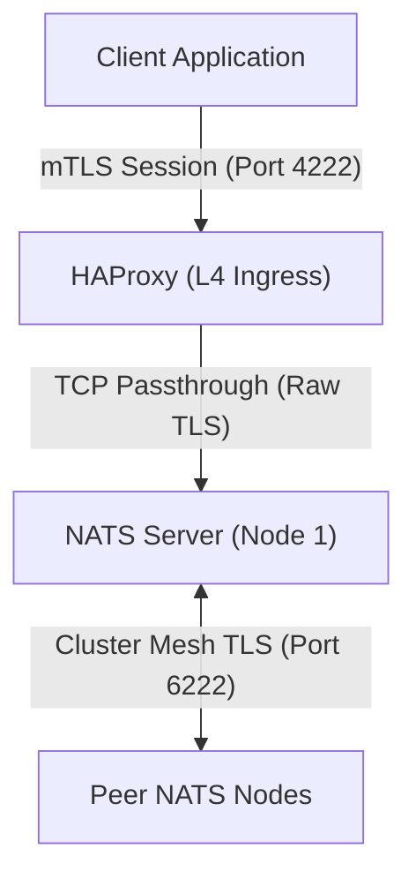

# Encryption

- Core Principle - Encryption protects NATS communication and persisted data against interception and unauthorized inspection.
- In-Transit vs At-Rest - Transport encryption (TLS) and storage encryption (disk/volume) operate as independent, non-overlapping security layers.
- Replication Separation - Raft data replication (availability) does NOT encrypt data; persisted copies must be encrypted independently.

---

## 1. Encryption in Transit

Secures network data paths across three distinct communication boundaries:



### A. Client-to-Server Ingress
Protects client payloads, subscriptions, and credentials using TLS.

- HAProxy L4 TCP Passthrough - HAProxy forwards raw TLS traffic without termination so the NATS server inspects the client certificate for mTLS.
- Cipher Suites & Versions - Enforces modern TLS (TLS 1.3 preferred, TLS 1.2 minimum).

### B. Server-to-Server Cluster Routes
Secures internal gossip, Raft consensus traffic, and cross-node message routing.

```conf
cluster {
  name: "local-nats-cluster"
  listen: "0.0.0.0:6222"
  tls {
    cert_file: "/etc/nats/certs/cluster-cert.pem"
    key_file:  "/etc/nats/certs/cluster-key.pem"
    ca_file:   "/etc/nats/certs/ca.pem"
    verify: true
  }
}
```

- Mutual Node Validation - `verify: true` requires every peer node to present a trusted certificate.
- Dual-Usage Certificates - Node certificates must include both `serverAuth` and `clientAuth` X.509 Extended Key Usage (EKU) flags.
- Isolation - Client TLS settings do not automatically apply to cluster routes; each transport must be configured explicitly.

---

## 2. Encryption at Rest

Protects persisted JetStream stream data, consumer state, and server metadata on disk:

| Layer | Implementation | Key Management | Operational Impact |
|---|---|---|---|
| Infrastructure Storage (Recommended) | Cloud block storage (EBS / Persistent Disks / LUKS) | Cloud KMS / Enterprise HSM | Transparent to NATS; zero server CPU overhead; covers snapshots and backups automatically. |
| NATS Native JetStream Encryption | Application-layer AEAD cipher (ChaCha20-Poly1305 / AES-GCM) | Server-injected `$JS_KEY` environment variable | Server-side CPU overhead; requires key distribution/rotation lifecycle management. |

### JetStream Native Encryption Configuration

```conf
jetstream {
  store_dir: "/data/jetstream"
  key: $JS_KEY
}
```

- Key Hygiene - Supply `$JS_KEY` exclusively via environment variables; never hardcode encryption keys in configuration files.
- Backup Protection - When using infrastructure encryption, ensure backups, volume snapshots, and disaster-recovery replicas are encrypted under the same KMS policy.

---

## 3. Storage Replication vs Encryption

Data replication and encryption address fundamentally different operational concerns:

- Replication (Availability) - Raft consensus with replication factor `R=3` replicates message data across 3 separate disks for fault tolerance. All copies remain plaintext unless storage encryption is active.
- Encryption (Confidentiality) - Protects disk blocks against offline inspection, compromised hardware, or unauthorized volume snapshots.
- Requirement - Every cluster node volume must have storage encryption independently enabled.

---

## 4. Operational Standard Matrix

| Boundary | Control | Mechanism | Key/Cert Source |
|---|---|---|---|
| Client Ingress | In-Transit | TLS 1.3 / mTLS (`verify_and_map`) | Enterprise PKI |
| Proxy Ingress | In-Transit | HAProxy Layer 4 TCP Passthrough | Client-managed TLS session |
| Cluster Mesh | In-Transit | Mutual TLS (`cluster.tls.verify: true`) | Internal Cluster CA |
| JetStream Volumes | At-Rest | Infrastructure Block Storage Encryption | Enterprise KMS |
| Volume Backups | At-Rest | KMS-encrypted snapshots | Cloud / Storage Provider |
